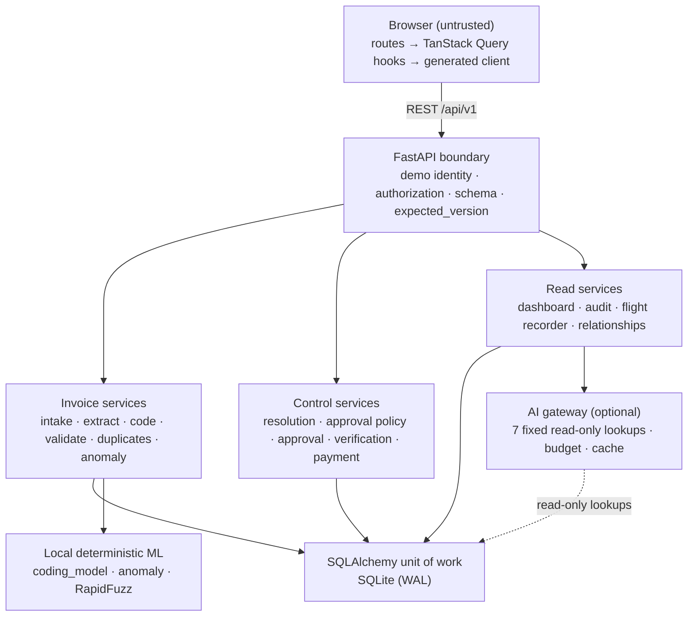

# Brim Sentinel — ARCHITECTURE.md

**Status:** architecture specification; actual implementation and test status must be verified against the repository. **Source of truth:** *Brim Sentinel PRD v1.4* (v1.4 amendments override the preserved v1.3 baseline) defines product and financial requirements; *BRIM_SENTINEL_MASTER_BUILD_PROMPT_V2.md* defines execution and integration requirements; this file records the implementation architecture. If this file conflicts with either authoritative source, reconcile it before coding and log the decision. Do not silently treat architectural assumptions as verified implementation facts.

> **One-line design:** the AI reads; deterministic code decides; humans authorize; every step is persisted and replayable.

---

## 1. Stack (decided)

| Layer | Choice | Notes |
|---|---|---|
| Frontend | **Existing TanStack Start + React + TypeScript app in `frontend/`, built with Vite**, using TanStack Router file routes, Tailwind/shadcn/ui and Radix UI; **Bun** is the selected package manager | Confirmed from the user-provided `frontend/package.json`, project tree and successful `bun run build` on 21 Nov 2026. Preserve the existing Lovable UI, SSR entry points, routing, assets and styling. **Do not migrate to Next.js.** |
| Server state | TanStack Query (`@tanstack/react-query`) | Query keys include actor ID and invoice version. |
| API client | Generated from backend `openapi.json` | Backend OpenAPI is authoritative; regenerate after every contract change. |
| Backend | Python 3.11+, FastAPI, Pydantic v2, SQLAlchemy 2 | Modular monolith, synchronous services. |
| Database | SQLite (WAL, `busy_timeout=5000`) | `DATABASE_URL` configurable; Postgres possible later, not needed. |
| Documents | PyMuPDF text first → Tesseract OCR fallback → optional Claude vision | Every extraction labelled with provenance (§6). |
| ML | scikit-learn (`app/ml/coding_model.py`), pandas/numpy (`app/ml/anomaly.py`) | Reuse only if present; reproduce tests before claiming implementation or accuracy; see §8. |
| Fuzzy matching | RapidFuzz | Duplicate and vendor-alias candidates. |
| AI | Anthropic API behind one gateway, **`AI_ENABLED=false` by default** | Demo and tests run with AI off. |
| Tests | pytest (backend), Vitest (frontend), Playwright (critical path) | |

**Not used, on purpose:** Next.js, Redis/Celery/queues, microservices, Neo4j/graph DB, LangGraph/multi-agent frameworks, Z3 (cut first), real payment rails. Do not add infrastructure for appearance.

---

## 2. Repository layout

```text
Brim-Sentinel/
  PRODUCT.md                 # PRD v1.4; normative amendments take precedence
  MASTER_PROMPT.md           # master build prompt v2.0 (if renamed; otherwise retain original filename)
  ARCHITECTURE.md            # this file
  FINANCIAL_RULES.md         # P01–P13 + edge cases; create at Gate 0 if absent
  ACCEPTANCE_TESTS.md        # AT-01..AT-48 → actual test file → verified status
  IMPLEMENTATION_STATUS.md   # truthful feature/test/blocker matrix
  API_CHANGELOG.md
  .env.example
  data/brim_ap_dataset/      # supplied synthetic dataset; verify location and tracked status
    data/*.csv  inbox/emails.json  incoming_invoices/*.pdf|png
  data/hidden/               # optional local unseen test batch (gitignored; do not assume available)
  backend/
    app/
      main.py                # FastAPI app, routers, error handler, CORS (local origin only)
      api/                   # thin routers: parse → authorize → call service → serialize
      core/                  # config, demo identity, permissions, errors, money
      db/                    # models, session, seed/import
      schemas/               # Pydantic DTOs (canonical names in §5)
      services/              # business logic (§4); no FastAPI imports
        connections_reference.py   # tested reference for RelationshipQueryService (P2)
      ml/
        coding_model.py      # FR-03, existing, tested
        anomaly.py           # §5B, existing, 9 tests
      integrations/ai_gateway.py   # the ONLY module that calls a model
    tests/
      test_anomaly.py        # run if present; do not presume passing
  frontend/                  # existing TanStack Start + Vite app; preserve routes, SSR and styling
    package.json             # @tanstack/react-start, react-router, react-query, Vite
    bun.lock                 # canonical lockfile after Bun build verification
    src/routes/              # TanStack Router file routes
    src/router.tsx           # router entry
    src/routeTree.gen.ts     # generated route tree; do not hand-edit
    src/server.ts            # server entry
    src/start.ts             # Start entry
    src/components/ConnectionsGraph.tsx   # optional P2 stretch, only if present
  scripts/                   # seed, import, eval, smoke, demo (as implemented)
  docs/reference/            # optional model methodology and reproducible metrics
```

---

## 3. Trust boundaries and dependency direction



Rules:
1. **Only backend services change invoice, case, approval or payment state.** Routers stay thin. Services never import FastAPI. Repositories never import routers.
2. **The browser is never authoritative** for role, amount, approval state, verification status or route. The UI renders `allowed_actions` / `blocked_reasons` returned by the server; the server re-checks on submit.
3. **All model calls go through `integrations/ai_gateway.py`.** AI tool handlers may call read services only, never mutation services.
4. No circular service dependencies; composition happens in explicit command handlers.

---

## 4. Services (boundaries are binding, filenames flexible)

| Service | Responsibility | Existing code |
|---|---|---|
| IntakeService | classify email + each attachment; SHA-256; drafts / non-payable items / missing-document items; idempotent re-import | — |
| ExtractionService | fields, lines, taxes, evidence, provenance, uncertainty | — |
| CodingService | GL + department suggestion, confidence, 3 similar lines, override with reason | `app/ml/coding_model.py` |
| ValidationService | deterministic findings `PASS/FAIL/UNKNOWN/NOT_APPLICABLE` with evidence and blocking flag | — |
| DuplicateService | exact → alias-aware → near → paid history → Brim card candidates | — |
| AnomalyService | as-of priority score, baseline stats, component breakdown (advisory only) | `app/ml/anomaly.py` |
| ApprovalPolicyService | ordered chain from P01–P13, merged steps, eligible actors, escalation | — |
| ApprovalService | record a human decision bound to invoice version | — |
| VendorVerificationService | trusted-contact callback provenance; bank-change state machine | — |
| ResolutionService | persistent cases, deterministic Path to Pay, allowed next actions | — |
| PaymentService | prepare/schedule/release **simulated** EFT; transactional gates; idempotency | — |
| InvestigationService | bounded read-only investigation; deterministic fallback | — |
| AuditService | append-only events, role-scoped query, CSV export, Flight Recorder | — |
| DashboardQueryService | role-scoped counts and task rows (FR-10) | — |
| RelationshipQueryService | evidence-backed graph (P2) | `services/connections_reference.py` (port it) |

---

## 5. Data model, money and versions

**Tables:** User, Department, Vendor, VendorBankChange, VerifiedPaymentRoute, Contract, PurchaseOrder, Invoice, InvoiceVersion, InvoiceLine, Document, EmailMessage, CodingSuggestion, ValidationFinding, DuplicateCandidate, ResolutionCase, ResolutionAction, ApprovalPolicy, ApprovalStep, ApprovalDecision, Payment, IdempotencyRecord, CardTransaction, AuditEvent, EvidenceReference, AnomalyResult, AgentInvestigation.

**Money:** integer minor units (`amount_minor`, `amount_cad_minor`) plus explicit currency. `Decimal` for intermediate tax/FX math with `ROUND_HALF_UP` at currency boundaries. **No floats in any payment, threshold, tax or approval decision.** (`anomaly.py` uses floats; that's acceptable only because its output is advisory and never gates money.)

**FX:** USD invoices converted at the `fx_rates.csv` rate for the **invoice date**; rate and date stored on the InvoiceVersion. Missing rate → UNKNOWN → hold.

**Versions:** every invoice has an immutable current version and immutable history. Findings, coding, approvals, route selection and evidence reference a version. A material edit (amount, currency, vendor, terms, payment destination, relevant coding) creates a new version, **invalidates all prior approvals**, and re-runs validation.

**Concurrency:** every mutation carries `expected_version` or equivalent concurrency token; mismatch → HTTP 409 and no partial side effects. Distinguish the immutable business invoice version (material edits) from a mutation revision/row token (approvals, cases, and other writes); both must be checked where applicable. Serialize competing financial mutations using an explicit SQLite write transaction and re-check all release gates inside that transaction. Unique constraints:
- `(invoice_id, version, step_id)` on ApprovalDecision
- at most one RELEASED payment per invoice version
- `(actor_id, operation, idempotency_key)` on IdempotencyRecord: same key + same payload → original result; same key + different payload → 409
- `(source_email_id, attachment_sha256)` on Document (import idempotency)

**Lifecycle:** `RECEIVED → DRAFT → EXTRACTED → CODED → VALIDATED → (ON_HOLD ↔ RESOLUTION) → PENDING_APPROVAL → APPROVED → SCHEDULED → RELEASED → SETTLED`, plus `REJECTED / CANCELLED / FAILED`. Transitions live in one table in `services/lifecycle.py`; anything not listed is rejected and audited.

**Case states:** `OPEN → INVESTIGATING → AWAITING_INFORMATION | AWAITING_VERIFICATION | AWAITING_AUTHORIZATION → READY_FOR_REVALIDATION → RESOLVED | REJECTED | CANCELLED`. Case status ≠ bank-change status (separate state machine: `REQUESTED → PENDING_INDEPENDENT_VERIFICATION → VERIFICATION_RECORDED → PENDING_ROUTE_AUTHORIZATION → AUTHORIZED → REVALIDATION_REQUIRED → CLOSED`).

---

## 6. Intake and extraction

- One draft per payable attachment (EM-029 → two). EM-058 → missing-document item. EM-056/057/059 → non-payable. Credit notes → negative balance, never scheduled.
- Extraction provenance on every field set: `pdf_text | ocr | vision | manual | demo_fixture`. Fixture output is never labelled as live OCR.
- Pipeline: PyMuPDF text → if empty/low coverage, Tesseract → if still insufficient and `AI_ENABLED`, Claude vision → else `NEEDS_MANUAL_EXTRACTION`.
- Raw and normalized values kept side by side (invoice number, dates, amounts). French accents preserved. Ambiguous dates → UNKNOWN.
- Arithmetic is recomputed from lines with an explicit tolerance; mismatches are findings, never silent corrections.

---

## 7. Financial controls (summary — full table in `FINANCIAL_RULES.md`)

- Approval chain from P01–P13 by CAD amount at invoice-date FX; merge duplicate finance-manager steps (P02/P05/P06/P12) keeping every triggering policy ID; one person fills at most one step per version.
- CFO = U001 by title (role `controller_admin`); no invented `cfo` role; fail closed if missing.
- U012 on leave → delegate U003, but U003 cannot fill two steps → escalate the conflicting step to controller and record why.
- Terminated requester U015 cannot act; department manager owns rework.
- Release ≤ CAD 100k: finance-manager authority; > 100k: controller_admin; releaser must not have approved this version (P11). Above CAD 10k the finance manager normally approved, so a controller/CFO who did not approve releases. Above 250k → `NO_ELIGIBLE_RELEASER` hold. **Never** solved by a superuser.
- Release runs in one DB transaction that re-reads version, holds, approvals, verified route and releaser's prior approvals.
- Bank changes: an unverified `bank_change_history` row is a hard hold **even when the invoice account matches the vendor master** (Cascadia V004 / BC-009). Verification needs trusted-contact provenance + authorized verifier; no `verified=true` from the client.
- AI/service identities have zero approve/verify/release/policy-edit permissions.

---

## 8. ML and anomaly (existing code — reuse, don't rewrite)

**`app/ml/coding_model.py` (FR-03; reported existing, verify in repository).** TF-IDF (word 1–2 + char 3–5) + one-hot vendor/category/default GL/province → logistic regression; text-only model + kNN blend for unseen vendors; department from PO/requester first. CLI: `evaluate | train | suggest`. **Reported evaluation in the supplied architecture (not independently reproduced here)** (train ≤ 2026-08-31, test Sep–Oct, 146 lines):

| | Baseline | Model |
|---|---|---|
| GL | 97.9% (vendor default) | 100%; **85.9% on unseen vendors** |
| Department | 91.8% (vendor most common) | 91.8% (**ties baseline**); 95% accurate on the 95% auto-filled |

Pitch the unseen-vendor GL and the confidence gate, not "100%". Below 0.70 confidence → human review.

**`app/ml/anomaly.py` (§5B / A4).** Deterministic: log-amount median + MAD (floor 0.04), robust z, empirical-Bayes shrinkage toward category, signal groups (amount, pricing, timing, identity, pattern), grouped noisy-OR, as-of date, credit notes excluded. The supplied architecture reports that P2 components exist and pass 9 tests; treat this as **unverified until the repository and tests are inspected**. PRD v1.4 A4 permits advanced scoring only if already implemented, reproducible, and after core gates. The output is a *review priority*, never a fraud probability, and never clears or creates a payment block on its own; hard blockers stay in ValidationService.

Integration notes for AnomalyService:
- Replace `parse_incoming()` (a regex stand-in) with ExtractionService output.
- Read history from the DB, not CSVs; keep `as_of` semantics; persist `AnomalyResult` with inputs and method version.
- For suppliers with < 5 own invoices, the UI must say "limited supplier history" (A4/AT-48).

Reproduce before quoting: `pytest -q backend/tests/test_anomaly.py` and `python backend/app/ml/anomaly.py incoming data/brim_ap_dataset`.

---

## 9. AI gateway and investigation (v1.4 A3)

- Model-visible tools, all parameterized, ID-validated, actor/case-scoped, read-only, bank data masked: `get_invoice_evidence`, `get_vendor_profile`, `get_bank_changes`, `get_contract_terms`, `find_related_invoices`, `get_card_transactions`, `get_approval_history`. **No SQL tool. No write tool.**
- Limits: 8 calls per investigation, 3 s per lookup, 200 rows, per-case and per-day token/cost caps, bounded retries.
- Output schema: `{summary, evidence[], proposed_actions[], open_questions[], complete}`. ResolutionService validates `proposed_actions` and stores them as PROPOSED. Numbers/names not present in cited evidence → reject and show the deterministic template.
- Cache key: `(case_id, invoice_version, evidence_hash, model_id, prompt_version)`. Fixture-replay mode for demo/tests.
- Model selection is configurable and optional; do not require a specific model/version for demo correctness. Every lookup logged to AuditEvent (name, sanitized args, row count, result hash, duration, model, cost).
- AI off or failing → deterministic findings and Path to Pay; holds unchanged.

---

## 10. API conventions

- Base path `/api/v1`; `GET /health`; `/openapi.json` generated and committed for the frontend client.
- Demo identity: `X-Demo-User-Id` header accepted **only** when `DEMO_MODE=true`; otherwise 401. UI label: "Demo identity — not authentication."
- Error shape: `{"error": {"code", "message", "details", "correlation_id"}}`. Status codes: 400/422 invalid input; 401 no identity; 403 role/scope; 404 missing or not visible; 409 version/idempotency/transition conflict; 422 unmet business prerequisite; 503 optional AI/OCR unavailable.
- Every mutation returns the new resource version plus `allowed_actions` and `blocked_reasons`.
- Canonical DTOs (InvoiceSummary, InvoiceDetail, ValidationFinding, ApprovalStep, ResolutionCase, Payment, AuditEvent, Graph) as listed in the master brief §20.

### Configuration (`.env.example`)
```
BRIM_DATA_DIR=../data/brim_ap_dataset
DATABASE_URL=sqlite:///./brim.db
DEMO_MODE=true
AI_ENABLED=false
AI_FIXTURE_REPLAY=true
AI_MAX_CALLS_PER_CASE=8
AI_DAILY_BUDGET_USD=5
ANTHROPIC_API_KEY=
FRONTEND_ORIGIN=http://localhost:8080  # observed local Vite dev URL; configure to actual runtime origin
```

### Run locally
```bash
# backend
cd backend && python -m venv .venv && source .venv/bin/activate
pip install -r requirements.txt
python -m scripts.seed            # idempotent
uvicorn app.main:app --reload --port 8000

# frontend
cd frontend && bun install && bun run dev
# production build: bun run build
```

---

## 11. Decision log

| # | Decision | Why |
|---|---|---|
| D1 | Keep existing TanStack Start + React/TypeScript + Vite frontend with Bun instead of Next.js | `package.json` shows `@tanstack/react-start`, `@tanstack/react-router`, `@tanstack/react-query` and Vite; `bun run build` succeeded. No framework migration. |
| D2 | Light Lovable theme for the product UI | PRD v1.4 A1 + master brief §19.2. The charcoal/royal-blue canvas was a design exploration. |
| D3 | SQLite, synchronous services, no queue | Demo scale; fewer failure modes; transactions are simple. |
| D4 | Integer minor units for money | Exact comparisons at 10k/50k/100k/250k boundaries. |
| D5 | Fixed read-only AI lookups, no SQL tool | PRD v1.4 A3. |
| D6 | Conditionally ship advanced anomaly P2 code | A4 allows it only when existing code and tests are reproduced; core gates first. |
| D7 | Relationship graph is P2 | A2; verify whether component exists; build only after Gates 1–3 pass. |
| D8 | Dataset location is configurable; keep unseen tests separate | Use `BRIM_DATA_DIR`; do not commit sensitive or hidden judge data. |

---

## 12. Ownership, autonomous coordination and integration

**Source alignment:** The master prompt specifies a lead/orchestrator responsible for architecture, contract, integration, and release gates; Claude Code owns backend and Codex owns frontend. An unattended local runner may execute the lead's routine duties **only when the relevant CLI tools and permissions are actually available**. Desktop app windows alone do not establish inter-agent communication.

- **Claude Code:** `backend/`, backend tests, `scripts/`, imports, schema, finance rules, API and OpenAPI generation.
- **Codex:** `frontend/`, UI, generated API client, frontend and Playwright tests.
- **Orchestrator/integrator:** shared docs and contracts, scheduling, dependency handoffs, isolated integration worktree, merge conflict routing, complete test gates and truthful status. Never let two workers edit the same shared file concurrently.
- **Git:** isolated branches/worktrees, meaningful commits, no force-push, destructive reset, branch deletion, secrets in commits or overwrite of unrelated changes. Never treat a merge as human financial authorization.

### Autonomous handoff protocol

1. Audit the repository and actual CLI/tool availability; preserve existing TanStack Start code and Bun package manager. Locate PRD/master prompt and the dataset. Record unknowns rather than guessing.
2. At Gate 0, create/update `FINANCIAL_RULES.md`, `ACCEPTANCE_TESTS.md`, draft `API_CONTRACT.yaml`, `IMPLEMENTATION_STATUS.md` and `API_CHANGELOG.md`. Assign one owner to each shared file.
3. Freeze initial DTOs and endpoint names; backend-generated `openapi.json` becomes authoritative. Publish committed contract changes into the frontend worktree before dependent UI tasks start.
4. Run independent agent tasks in separate worktrees; each commits verified increments. The integrator merges into a **disposable integration worktree** and runs backend tests, frontend build/tests, contract compatibility and critical Playwright flows. Promote only verified commits.
5. Route failures with exact commands and logs to the responsible agent. Limit repair attempts (recommended: three per task); on repeated failures, blocked dependencies or budget exhaustion, stop that task and record a precise blocker instead of weakening requirements.
6. Keep `IMPLEMENTATION_STATUS.md` evidence-based: requirement, actual file/commit, tests run, result, owner, next action. At completion report real seed counts, AT-01–AT-48 coverage, skipped tests, demo commands and Git hashes.

### Unattended safety limits

- Financial control tests and hard holds are **non-bypassable gates**. No auto-approval, no fabricated verification, no payment-route authorization by AI and no real transfers.
- Limit subprocess runtime, retries and AI/API cost. Do not grant blanket permission for destructive commands, secret access, deployment or external financial actions.
- Automatic integration is not unconditional automatic merging to protected `main`: honor repository protections, permissions and any owner-approval requirement. If blocked, leave a tested integration branch and a clear report.
- The runner may resolve routine technical failures but must not change PRD requirements or financial invariants to obtain a green test suite.

---

## 13. Source precedence and verification checklist

1. **PRD v1.4**: v1.4 change sheet and normative amendments override the preserved v1.3 baseline; product scope, controls, UX and AT-01–AT-48 are binding.
2. **Master Build Prompt v2.0**: implementation sequence, preservation of existing Vite frontend, service boundaries, API handoffs, tests and agent coordination.
3. **This architecture**: concrete engineering choices consistent with the above; it is not evidence that a module exists or a test passes.
4. **Live repository**: authoritative for what is currently implemented, which frontend framework/router/package manager is installed, and which tests actually pass. Report differences instead of silently replacing source requirements.

**Gate 0 verification:** confirm frontend package versions and Bun lockfile consistency; verify source files, model metrics and anomaly tests; locate actual PRD/dataset paths; generate the initial API contract; establish a deterministic financial-rules decision table; run baseline tests before describing the code as complete.
